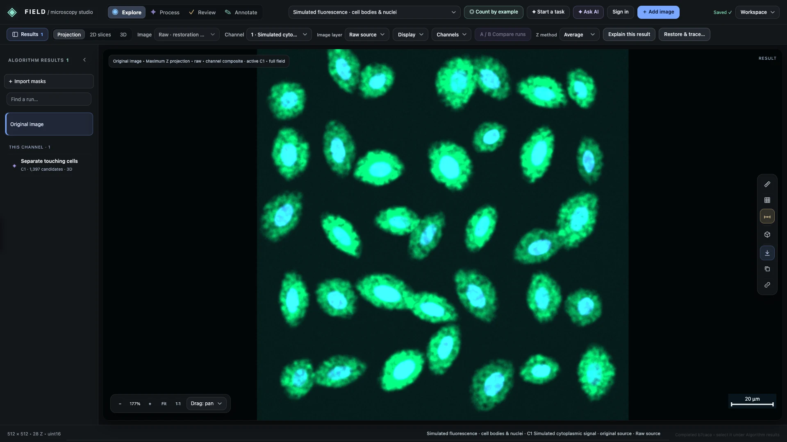
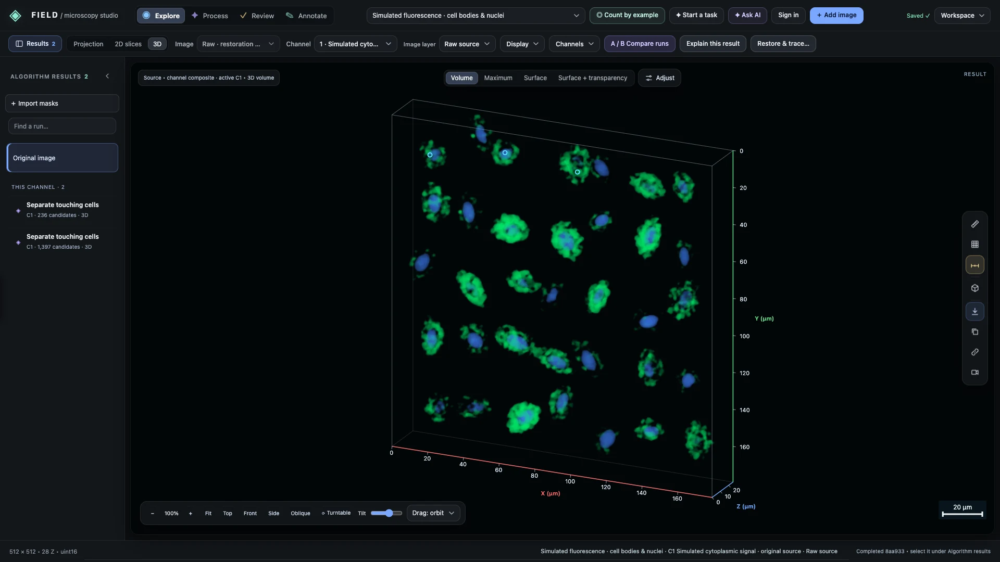
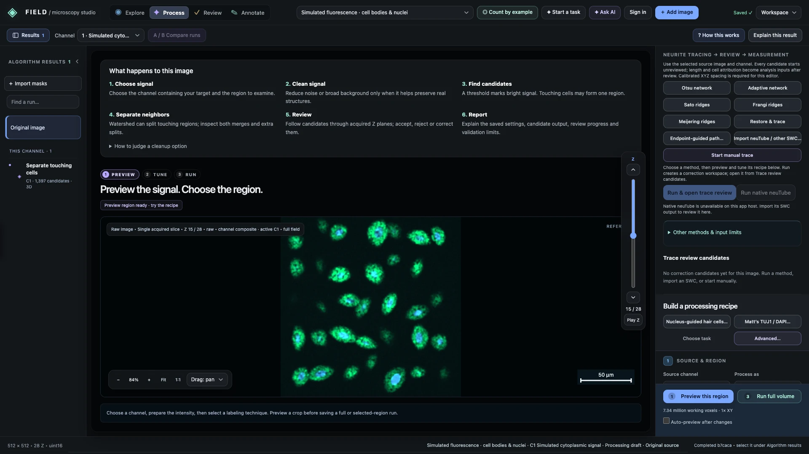
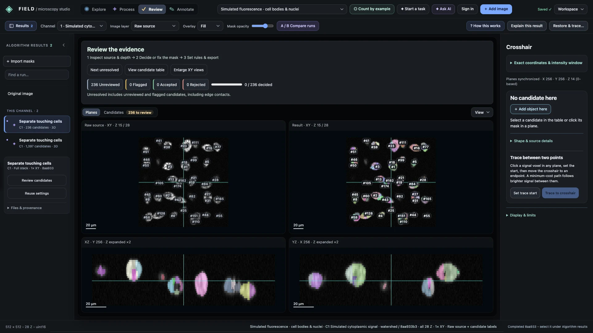
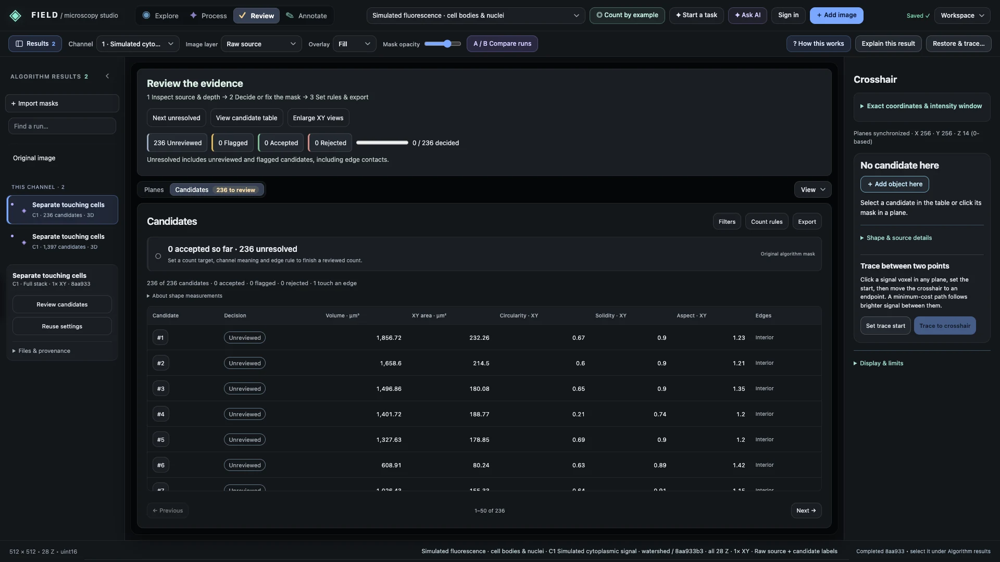
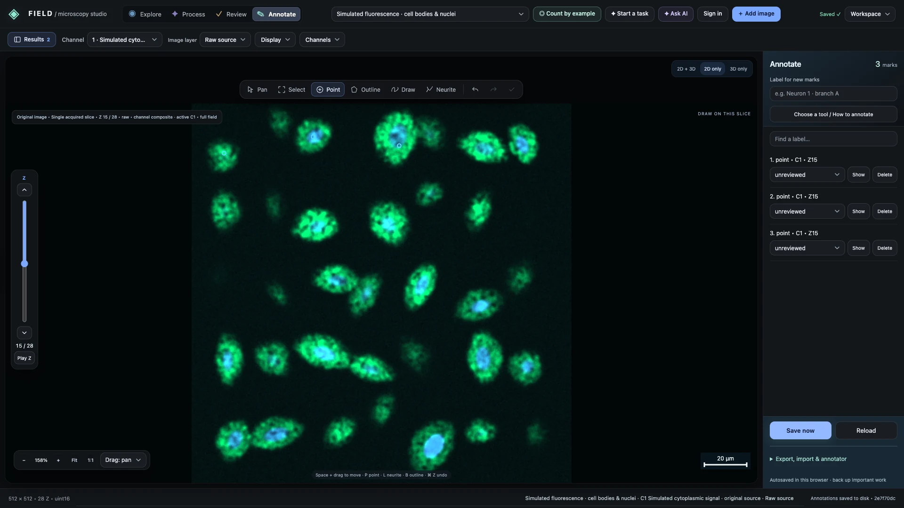
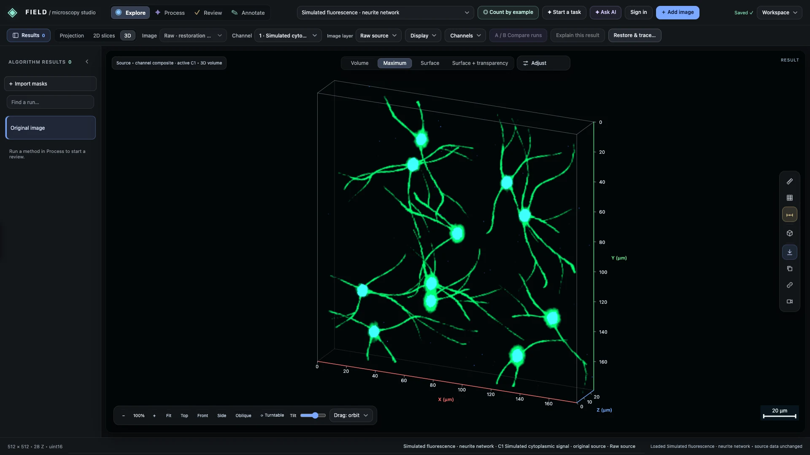
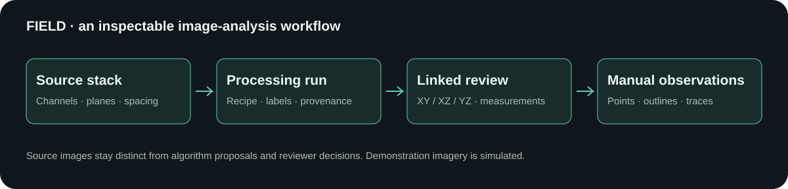

> From a multichannel image stack to a result a researcher can inspect.

I built FIELD to bring microscopy exploration, image processing, candidate review, and annotation into one workspace. Instead of presenting a segmentation as a finished biological answer, the interface lets a researcher inspect how it was produced and compare it with the source image.

**Project type:** Research software / scientific visualization

**Technology:** Python, NumPy, SciPy, scikit-image, JavaScript, Canvas/WebGL, OME-TIFF

**Presentation data:** Every microscopy image on this page shows fully procedural simulated fluorescence in the actual local application. No private research scans or patient images are included.

## The problem

A fluorescence image is a stack of channels and depth planes, not just a flat photograph. A region that looks like one object in a projection may contain several structures at different depths. Processing settings change the regions an algorithm proposes, and a plausible overlay still needs review against the original signal.

FIELD brings those steps together: inspect the source, choose an analysis recipe, generate candidates, review them in acquired planes, and export the result with its context.

## Explore the source

*A maximum projection combines two simulated fluorescence channels in FIELD’s Explore workspace. Simulated data.*

Channels can be viewed separately or combined. Projection, slice, and 3D views support different questions: where signal appears, which acquired plane contains it, and how the stack is arranged in space. Display changes do not alter the source pixels.

*Rotate the same simulated source stack to inspect spatial context. Simulated data.*

The 3D view gives spatial context; acquired 2D planes remain the place to inspect boundaries. Rendering interpolation is a display choice and does not create new observations.

## Build a processing recipe

*Select a source channel, preview the image, and run a configurable watershed recipe. Simulated data.*

The processing workflow separates source/channel selection, signal cleanup, and candidate detection. A researcher can choose processing scope and working resolution, tune thresholds and splitting parameters, and save runs for comparison. Classical methods include connected regions, watershed splitting, and ridge enhancement.

For this demonstration, a real watershed job ran against a simulated 28-plane image stack. The screenshots show the resulting saved run, rather than a painted-on segmentation overlay.

## Inspect candidates in context

*Source and result views share native XY/XZ/YZ context for candidate inspection. Simulated data.*

Linked orthogonal views make a proposed region inspectable across depth. A shared crosshair connects the acquired planes so a reviewer can examine whether a candidate follows the source signal.

*A saved run exposes candidate measurements and separate reviewer decisions. Simulated data.*

The candidate table exposes measurements and review state. Versioned reviewer decisions are separate from the original algorithm output; a candidate count alone is not a validated biological count.

## Add manual observations

*Three illustrative point marks demonstrate coordinate-aware annotation and saving. Simulated data.*

Manual points, outlines, and open traces preserve native image coordinates, channel, and depth context. The demonstration saves three illustrative point marks. Those marks show the interaction and persistence path; they are not expert annotations or training labels.

## Explore neurite-like structures

*A procedural neurite-like network demonstrates multichannel volume exploration. Simulated data.*

The same viewer supports branching, neurite-like signal. Its spatial context helps explain why apparent crossings need inspection. A connected bright structure does not by itself establish neuron identity or ownership.

## How the workspace fits together

The source stack, processing runs, and reviewer observations stay connected through shared image coordinates and provenance.

## Engineering decisions

- **Keep evidence inspectable.** Source pixels, processing outputs, manual marks, and review decisions have distinct roles.
- **Preserve coordinate context.** Working resolution and calibrated spacing are recorded so displayed results can be related to the source stack. In these examples, spacing is simulated.
- **Use one engine across workflows.** Python handles image decoding, numerical processing, and measurements. JavaScript provides linked navigation and interactive rendering.
- **Support portable results.** The project provides image/label TIFFs, measurements and provenance, annotation exports, and workspace backups. Export options depend on the selected workflow.

## What this demonstrates

FIELD combines scientific image processing with product engineering: a researcher can move from a raw stack to an inspectable run and add their own observations without leaving the workspace. The emphasis is on making algorithm behavior visible and reviewable.

This portfolio demonstration verifies local exploration, a saved watershed run, linked review, candidate measurements, and saved point annotations. It does not establish biological accuracy, clinical utility, production adoption, or a current public deployment. All images shown here are simulated; confidential research images are excluded.
